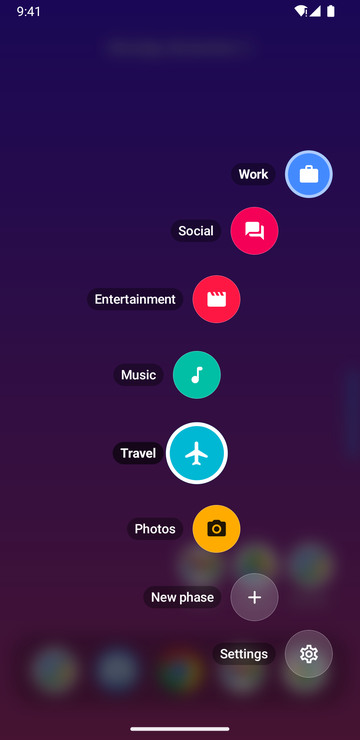
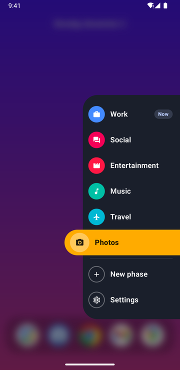
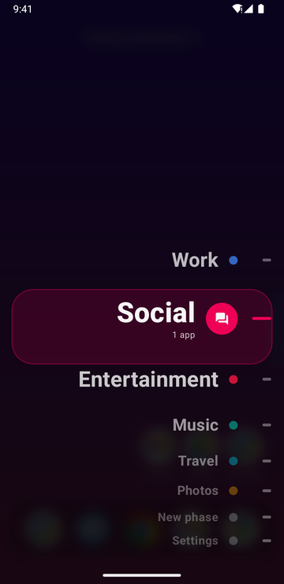
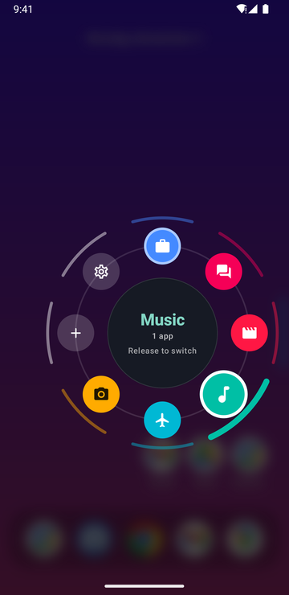
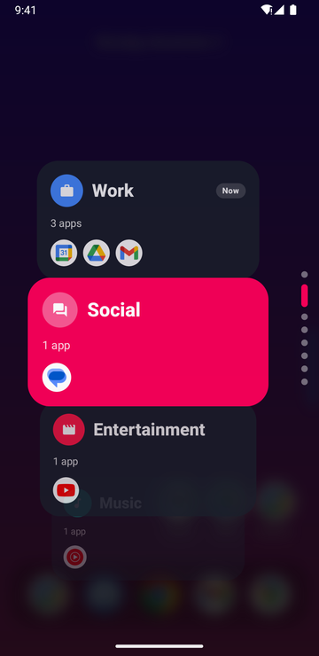
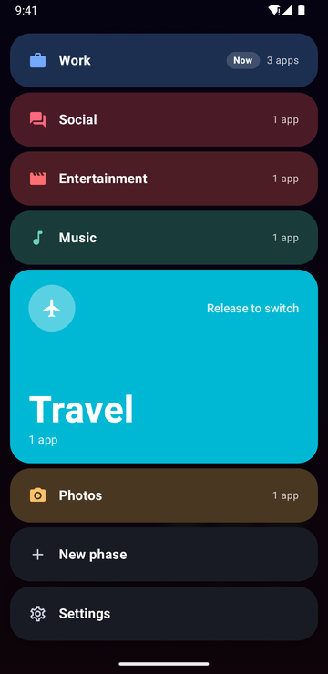

<h1 align="center">Phases</h1>

<p align="center">
  <strong>A home screen that changes with your day.</strong><br>
  Work, gym, weekend, night: give each part of your day its own apps, and switch with one swipe.
</p>

<p align="center">
  <a href="https://github.com/ioannismil/phaseslauncher/releases/latest"></a>
  <a href="https://github.com/ioannismil/phaseslauncher/actions/workflows/ci.yml"></a>
  
  
</p>

---

Most launchers show you everything, all the time. **Phases** shows you what you need *right now*. A phase is a named set of apps with its own look and behavior: your Work phase can show Mail and Calendar and silence the phone, while Weekend brings back the games and the music. Swipe in from the edge of the screen, slide to a phase, let go, and the whole home screen changes.

> [!NOTE]
> **This is a hobby project, made for me.** I built Phases to fit the way I use my own phone, so it follows my habits and my taste rather than a roadmap. There are no promises about features or timelines. You're very welcome to try it, fork it, or borrow ideas from it.

## What it does

- **Phases.** Each one has its own apps, folders, widgets, wallpaper, colors, icon pack and sound mode (sound on, vibrate, silent, do not disturb). A dock of favorites stays put whichever phase you're on.
- **Switch with a swipe.** Swipe in from the edge bar and pick a phase. Choose how they appear: an arc, an edge rail, a picker wheel, a dial, a card stack or color bands.
- **Switch automatically.** Rules can change phase by time of day, Wi-Fi network, Bluetooth device or place.
- **Stay focused.** A phase can hold back distracting apps and filter notifications until you switch away.
- **Works with your automations.** Tasker, Samsung Modes and Routines and shortcuts can switch phases too.
- **Share and back up.** Send a phase as a file, link or QR code, and save everything to a backup file.

## Pick your switcher

Swipe in from the edge bar and the phases fan out in the style you choose in *Settings → Phase switcher → Style*. Slide to one and let go to switch.

<table align="center">
  <tr>
    <td align="center"><br><b>Arc</b><br><sub>Phases fan out around your thumb</sub></td>
    <td align="center"><br><b>Edge rail</b><br><sub>A list slides out of the edge</sub></td>
    <td align="center"><br><b>Picker wheel</b><br><sub>Names scroll past as you slide</sub></td>
  </tr>
  <tr>
    <td align="center"><br><b>Dial</b><br><sub>A full circle; slide onto a phase</sub></td>
    <td align="center"><br><b>Card stack</b><br><sub>A card per phase, with its apps</sub></td>
    <td align="center"><br><b>Color bands</b><br><sub>The bar under your finger grows</sub></td>
  </tr>
</table>

## Download

Grab the latest APK from **[Releases](https://github.com/ioannismil/phaseslauncher/releases/latest)** and open it on your phone (Android 8.0 or newer). Each release installs over the one before, so updating is just installing the new one.

## Releasing

Every push to `main` and every pull request is built, tested and linted (*CI* workflow). To publish a version, push a tag:

```
git tag v0.4.0
git push origin v0.4.0
```

or run *Release* from the Actions tab with the version. The *Release* workflow builds a signed APK and publishes it on the Releases page with notes generated from the commits since the last release.

Signing uses the repository secrets `KEYSTORE_BASE64`, `KEYSTORE_PASSWORD`, `KEY_ALIAS` and `KEY_PASSWORD`. Keep a backup of the keystore: Android only installs updates signed with the same key.

## Build and run

Kotlin · Jetpack Compose · Material 3 · Room · DataStore · minSdk 26, target/compile SDK 37.

Requires JDK 17 and an Android Studio recent enough for AGP 9.4 / API 37, or just the command line:

```
.\gradlew.bat installDebug                 # build + install on the running emulator/device
.\gradlew.bat testDebugUnitTest            # JVM unit tests
.\gradlew.bat connectedDebugAndroidTest    # instrumented tests (uninstalls the app afterwards)
```

### Performance

- **Measure a release build** (R8 on, like the real thing; debug builds are several times slower): `.\gradlew.bat installRelease -PdebugSignedRelease` signs it with the debug key so it installs over a debug build.
- **Baseline profile:** `app/src/main/baselineProfiles/baseline-prof.txt` lists the code that runs at startup and in the drawer, so it's compiled ahead of time. Regenerate it after big UI changes with `.\gradlew.bat :app:generateBaselineProfile` (device or emulator, Android 9+), then copy the `*-prof.txt` from `baselineprofile/build/outputs/connected_android_test_additional_output/` over it.
- **Check it helps:** `.\gradlew.bat :baselineprofile:connectedBenchmarkReleaseAndroidTest` compares cold start and drawer frames with and without the profile (on an emulator add `-Pandroid.testInstrumentationRunnerArguments.androidx.benchmark.suppressErrors=EMULATOR`; real phones give the meaningful numbers).
- Debug builds run StrictMode and log disk/network work on the main thread and leaked resources.

## Make it the default home app

- **First launch:** setup ends with a "Set as default home app" button (system dialog on Android 10+).
- **Later:** long-press empty space on the home screen → *Set as default home app*.
- **Emulator / adb:** `adb shell cmd package set-home-activity com.phaseslauncher/.MainActivity`
- **Settings:** Apps → Default apps → Home app → Phases.

## Switch back to the normal launcher

- Settings → Apps → Default apps → Home app → *Pixel Launcher* (Samsung: *One UI Home*).
- adb (Pixel emulator): `adb shell cmd package set-home-activity com.google.android.apps.nexuslauncher/.NexusLauncherActivity`
- Last resort: `adb uninstall com.phaseslauncher` — Android falls back to the stock launcher.

## Using it

| Where | Gesture | What happens |
|---|---|---|
| Edge bar (right or left) | Swipe toward the middle, release on a phase | Switch phase (release back at the edge to cancel) |
| Edge bar / phase label under the clock | Tap | Open the phase arc; tap a phase, long-press it for Edit / Delete |
| Phase arc | Release on **+** / **Settings** | New phase / Launcher settings |
| Anywhere on home | Swipe up / swipe down / double-tap | Configurable in Launcher settings → Gestures (default: app drawer / notifications / nothing) |
| App (grid, dock, drawer) | Long-press | App shortcuts (e.g. New tab) + app menu (drawer: hide, uninstall) |
| App (grid, dock) | Long-press, then drag | Reorder |
| Empty space | Long-press | All apps, new phase, add widget, wallpaper, launcher settings |
| Widget | Long-press | Resize, move up/down, remove |
| App (grid, dock, drawer) | Long-press → Customize… | Rename, or pick an icon from an icon pack |
| App or shortcut (grid) | Long-press → Add to folder…, or drag onto another app or a folder and hold | Put it in a folder on this phase (new or existing) |
| App (drawer) | Long-press, then drag | Carry it to home: drop between apps, onto an app or folder, or onto the dock |
| Drawer | Drag the A–Z letters on the right | Jump to apps by first letter (when sorted A–Z) |
| Folder | Tap / long-press | Open it / Rename, Ungroup. Inside: long-press an app to move it out or remove it, long-press and drag to reorder |
| Another app's "Add to home screen" | Pick a phase | The shortcut (or widget) goes on that phase |
| Drawer search bar | Gear | Launcher settings (bar side, phases, default home, setup) |

## Launcher settings

- **Phase switcher:** bar on the left or right edge; phase list with reorder / edit / delete / new.
- **Clock & status bar:** time, date (with a choice of format) and battery percentage each on or off independently — any mix, e.g. only the time or only the battery (all off hides the header so apps use the full height); phase-name pill on/off (off: switch phases from the edge bar); position Left / Center / Right (the pill follows); status bar shown or hidden while Phases is on screen (swipe down from the top edge to see it briefly). The percentage in the system status bar itself can't be changed by apps.
- **Gestures:** swipe up, swipe down and double-tap can each open the drawer, search, notifications, quick settings, lock the screen (needs the accessibility service), open the phase switcher, go to the next/previous phase, open an app, or do nothing.
- **App drawer:** sort A–Z (with a letter rail), most used or recently installed; optionally open the keyboard whenever the drawer opens.
- **Home screen:** fit icons to the screen (columns and icon size chosen so the phase fits without scrolling; the icon size setting then sizes the dock), grid columns (3–6), icon size, app labels, notification dots, swipe down for notifications, wallpaper, default home app.
- **Notification dots** need notification access; turning the switch on takes you to the system screen to grant it.
- **Themed icons** (Android 13+): apps' monochrome icons, tinted with the active phase's color. Apps without one keep their own icon; icon packs and hand-picked icons take priority.
- **Apps:** hidden apps (hidden from the drawer and its search, not from phases or the dock).
- **Backup:** save phases (with folders), dock and settings to a JSON file, and restore from one. Pinned shortcuts aren't included: only the app that made one can pin it again.

Work profile and Private Space (Android 15+) apps get their own drawer tabs, with pause/resume and lock/unlock.

## Per-phase options (phase editor)

- **Widgets:** each phase has its own widgets, shown above its apps.
- **Wallpaper:** applied when you switch to the phase. Phases without one keep whatever wallpaper is set (Android doesn't let launchers read and restore your previous wallpaper).
- **Own dock:** the phase gets its own favorites instead of the shared dock.
- **Sound:** Sound on, Vibrate, Silent, or Do Not Disturb (priority / alarms only). Switching to a phase that doesn't change sound restores your own settings. Silent and DND need Do Not Disturb access.
- **Look:** its own icon pack and home grid (fit to screen or a column count), or the launcher settings.
- **Switch automatically:** any number of conditions, each with its own on/off switch: schedules, places (current location or coordinates, 50 m–2 km; "Allow all the time" location makes them work while another app is open), Wi-Fi networks (needs location access, as Android hides network names otherwise), calendar events (chosen calendars, title keywords, a few minutes early, all-day and free events optional), Bluetooth devices, headphones, a game controller, charging. Per phase: switch when *any* or *all* conditions hold, priority (Low–Highest; the higher one wins when two phases apply, then the more specific condition, then switcher order), wait 1–30 minutes before switching, switch back or stay when the conditions end, and *Ask first* (a prompt on the home screen instead of switching). Schedules and calendar events also set an alarm, so they apply even if Android stopped the launcher.
- **Focus:** while the phase is on, blocked apps (chosen ones, and optionally every app outside the phase and dock) show a pause screen (0–60 s wait, then open freely for 1–60 min) or don't open at all, and can be hidden from the drawer. Notifications: only from the phase's apps (plus extras) or from chosen apps; others lose their dots and can also be kept out of the shade (snoozed in 10-minute stretches, so they return soon after); calls, alarms and reminders can always get through (needs notification access). Daily limits per app and for all of the phase's apps together, counted while the phase is on or all day, with a pause or a block when time's up (needs usage access). The launcher can only hold back apps opened from it.
- **Share:** from the editor or the phase arc, as a file (optionally with the wallpaper), a `phases://` link or a QR code. Switching conditions and focus settings are optional; Wi-Fi networks, Bluetooth devices and places are left out unless you include them. Opening a link or file shows what's in the phase, which apps aren't installed (with Play Store links) and what to take; Settings → Phases can also import a file or a pasted link.

## Setup, import and suggestions

- **Starter phases:** setup offers Gaming, Work, Social, Entertainment, Music, Travel, News, Photos and Bedtime, each pre-filled with matching installed apps and starting conditions (e.g. Work on weekdays 9–17, Music with headphones, Bedtime while charging *and* 22:00–07:00 with Do Not Disturb). "Customize" opens the full phase editor for any of them. Settings → *Run setup again* offers them later.
- **Import from another launcher:** setup and Settings → Phases read backups from Nova Launcher (`.novabackup`), Lawnchair and other launchers built on Launcher3: each home page becomes a phase (or all in one), folders come along, the dock can replace yours. Widgets and shortcuts don't. Not tested against real backup files yet; other formats (e.g. Smart Launcher) aren't read.
- **Suggestions** (Settings → Suggestions, each kind can be turned off): adding an app you keep opening on a phase (threshold 3–20 opens in two weeks), a schedule for a phase you pick around the same time on 3+ days, and switching to an app's phase when you open it from another. Shown at the top of home with *Not now* (a week), *Never* and, for schedules, *Customize*. Learned from the last few weeks on the phone only; the history can be cleared.

**Quick Settings tile:** add the "Phase" tile to switch phases from the notification shade.

## Switching from other apps (Tasker, Samsung Modes and Routines)

Other apps can switch phases, so Phases can follow your system modes instead of competing with them. A switch from another app acts like picking the phase yourself: the phase's wallpaper and sound apply, and rules that apply at that moment don't undo it. These switches don't feed schedule suggestions.

- **Broadcast** (Tasker, MacroDroid, Automate, adb): first turn on Settings → Automation apps → *Other apps can switch phases*. It's off by default, because a phase can silence the phone and hold back apps. Then send:
  - action `com.phaseslauncher.action.SWITCH_PHASE`, package `com.phaseslauncher` (Android only delivers it with the package set);
  - extra `phase` with the phase's name (any case), or `phase_id` with its id.

  In Tasker: *Send Intent* → Action as above, Extra `phase:Work`, Package `com.phaseslauncher`, Target *Broadcast Receiver*. From adb: `adb shell am broadcast -a com.phaseslauncher.action.SWITCH_PHASE -p com.phaseslauncher --es phase Work`. The result code is `-1` on success, `1` if no phase matches and `2` if the setting is off, with the reason as the result data.
- **App shortcuts:** each phase gets a "Switch to …" shortcut, kept in step with your phases. Apps that run app shortcuts, such as Samsung Modes and Routines and Google Assistant, can use them, and they show when you long-press Phases in an app list. They don't need the setting.
- **Link / activity:** `phases://switch?phase=Work` (or `?phase_id=12`) opened as an activity, for example with Tasker's *Send Intent*, Target *Activity*. Also works without the setting. Android doesn't let background apps start activities, so this only runs from something on screen or from an automation app the system trusts.

## Search

The drawer shows suggested apps (from what you open most and most recently). Searching also finds contacts (optional permission), system settings pages, and offers a web search; Go opens the top app or searches the web. Arithmetic ("12*(3+4)", "15% of 80", "80 + 15%") and unit conversions ("10 km to mi", "70 f to c") show the answer on top; tap it to copy.

## Code map

- `data/apps` — installed apps and profiles via `LauncherApps` (+ change callback), icon cache, search, app shortcuts
- `data/notifications` — notification dots listener; `data/backup` — JSON export/import; `data/system` — notification shade, lock-screen accessibility service
- `data/items` — folders, pinned shortcuts ("Add to home screen") and the item keys phases store; `ui/pin` — the phase picker shown for those requests
- `data/widgets` — app widget host; `data/icons` — icon packs, custom names/icons; `data/search` — contacts, settings, web
- `data/rules` — automatic switching rules, `RuleEngine` (which phase wins), calendar and location watchers, schedule alarm; `data/focus` — per-phase focus settings and the launch gate; `data/suggestions` — history and `SuggestionEngine`; `data/share` — phase files, links, QR codes; `data/importer` — other launchers' backups; `ui/tile` — Quick Settings tile; `api` — switching from other apps (broadcast, shortcuts, links); `data/themes/ThemeEffects` — per-phase wallpaper and sound
- `data/db`, `data/themes`, `data/settings` — Room (phases, assignments, favorites), repositories, DataStore
- `LauncherViewModel` — combines everything into `HomeState` / `DrawerState`
- `ui/home`, `ui/drawer`, `ui/editor`, `ui/onboarding` — screens; `ui/components/Reorder.kt` — drag-to-reorder
