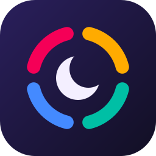
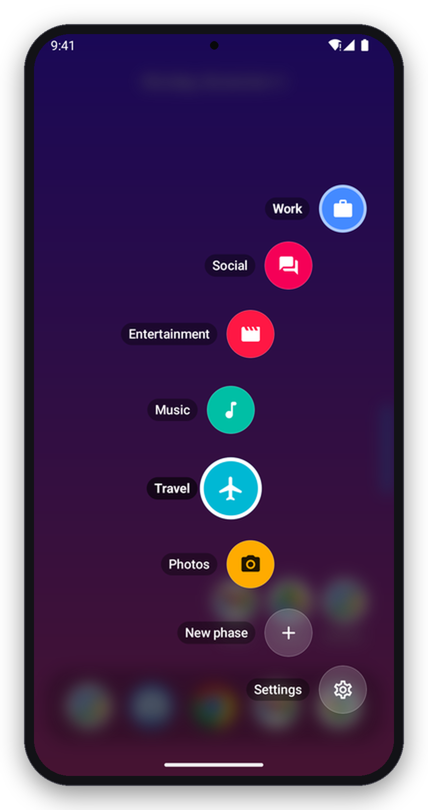
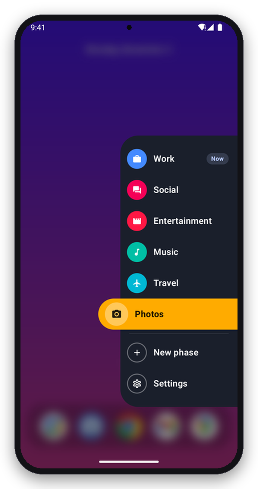
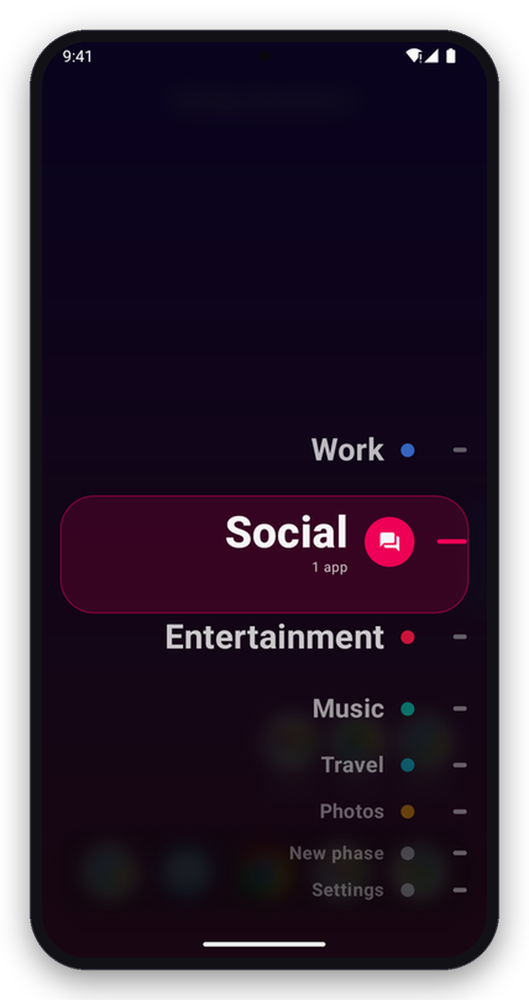
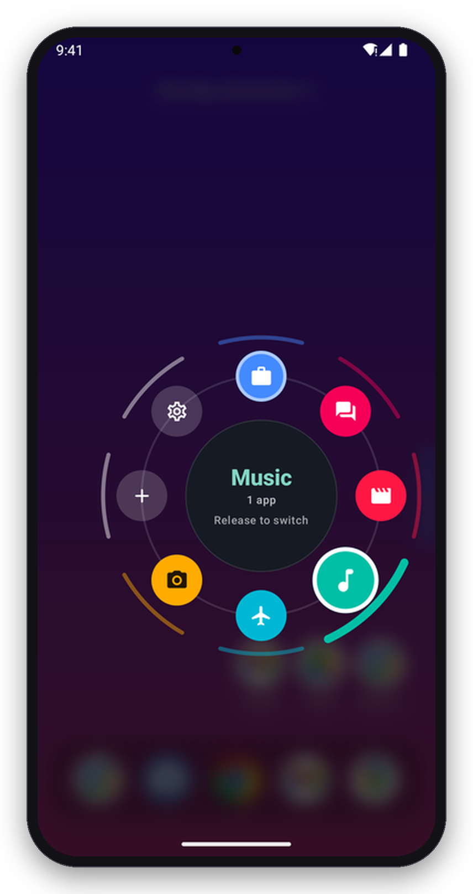
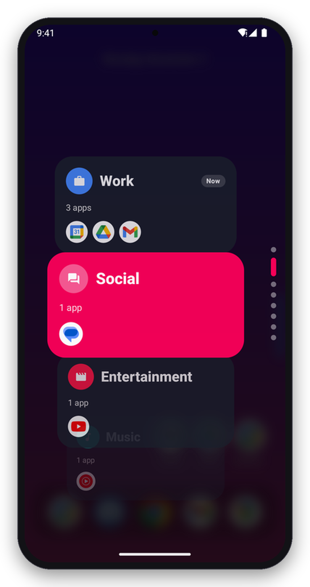
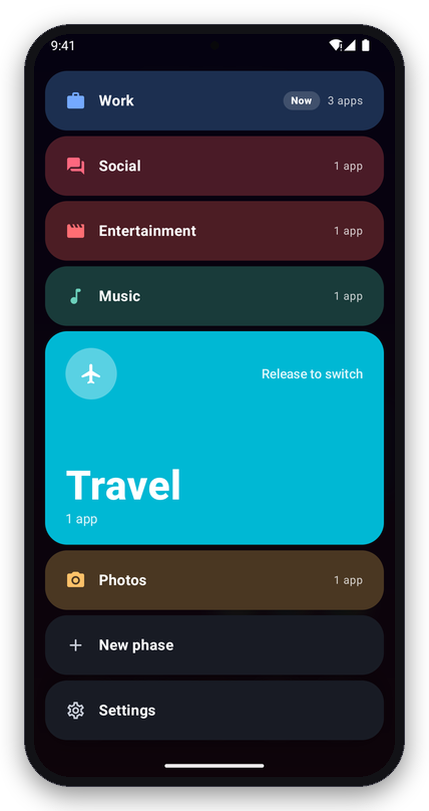

  

<h1 align="center">Phases</h1>

  <strong>A home screen that changes with your day.</strong> 
  Work, gym, weekend, night: give each part of your day its own apps, and switch with one swipe.

  
  
  
  
  

---

Most launchers show you everything, all the time. **Phases** shows you what you need *right now*. A phase is a named set of apps with its own look and behavior: your Work phase can show Mail and Calendar and silence the phone, while Weekend brings back the games and the music. Swipe in from the edge of the screen, slide to a phase, let go, and the whole home screen changes.

> [!NOTE]
> **This is a hobby project, made for me.** I built Phases to fit the way I use my own phone, so it follows my habits and my taste rather than a roadmap. There are no promises about features or timelines. You're very welcome to try it, fork it, or borrow ideas from it.

## What it does

- **Phases.** Each one has its own apps, folders, widgets, wallpaper, colors, icon pack and sound mode (sound on, vibrate, silent, do not disturb). A dock of favorites stays put whichever phase you're on.
- **Switch with a swipe.** Swipe in from the edge bar and pick a phase. Choose how they appear: an arc, an edge rail, a picker wheel, a dial, a card stack or color bands.
- **Switch automatically.** Rules can change phase by time of day, Wi-Fi network, Bluetooth device or place.
- **Stay focused.** A phase can hold back distracting apps and filter notifications until you switch away.
- **Works with your automations.** Tasker, Samsung Modes and Routines and shortcuts can switch phases too.
- **Share and back up.** Send a phase as a file, link or QR code, and save everything to a backup file.

## Pick your switcher

Swipe in from the edge bar and the phases fan out in the style you choose in *Settings → Phase switcher → Style*. Slide to one and let go to switch.

<table align="center">
  <tr>
    <td align="center"> <b>Arc</b> Phases fan out around your thumb</td>
    <td align="center"> <b>Edge rail</b> A list slides out of the edge</td>
    <td align="center"> <b>Picker wheel</b> Names scroll past as you slide</td>
  </tr>
  <tr>
    <td align="center"> <b>Dial</b> A full circle; slide onto a phase</td>
    <td align="center"> <b>Card stack</b> A card per phase, with its apps</td>
    <td align="center"> <b>Color bands</b> The bar under your finger grows</td>
  </tr>
</table>

## Download

Grab the latest APK from **[Releases](https://github.com/ioannismil/phaseslauncher/releases/latest)** and open it on your phone (Android 8.0 or newer). Each release installs over the one before, so updating is just installing the new one. With [Obtainium](https://github.com/ImranR98/Obtainium) you'll get updates automatically.

Phases doesn't ask for internet access. It has no ads, no tracking and no account, and everything it learns about your habits stays on your phone.

## Learn more

- **[Using Phases](docs/usage.md):** setting it as your home app, every gesture, launcher settings, per-phase options, setup and search.
- **[Switching from other apps](docs/automation.md):** Tasker, Samsung Modes and Routines, shortcuts and `phases://` links.
- **[What's new](CHANGELOG.md):** the changes in each release.
- **[Contributing](CONTRIBUTING.md):** building it, the code map and how releases are made.

## License

[MIT](LICENSE). Fork it, change it, borrow from it.
